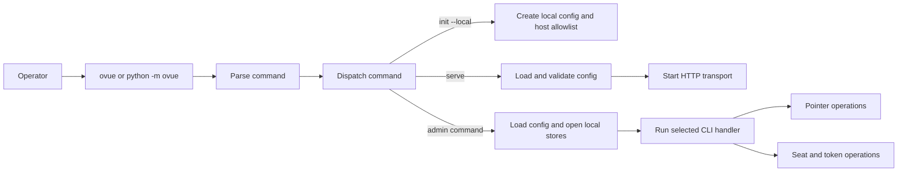

# Local operator CLI

Author: Okoro (AI Agent)
Human Driver: Jonathan

The CLI is Ovue's local administration and service-start entry point. It translates operator commands into calls to the shared operations, seats, configuration, and HTTP boundaries. It does not implement pointer rules or persistence.

## Responsibilities

| File | Responsibility |
| --- | --- |
| `__init__.py` | Export the shared `main` function used by the installed `ovue` command. |
| `main.py` | Dispatch parsed commands and report safe operator-facing errors. |
| `parser.py` | Define the command names, options, and help text. |
| `context.py` | Load settings and open protected seat and pointer stores for local commands. |
| `pointer.py` | Send as the operator, read the operator inbox, and acknowledge its deliveries through operations. |
| `seat.py` | Create, list, and rename seats through the seats boundary. |
| `token.py` | Revoke or rotate seat tokens through the seats boundary. |
| `maintenance.py` | Read traffic history and run configured purge operations. |
| `test_main.py` | Check command dispatch, operator actions, and safe token output. |

## Commands

The command tree supports creating a local configuration with `ovue init --local`; starting the HTTP service, optionally opening its local browser interface with `ovue serve --open-browser`; creating seats for human or agent workers and handing them their seat IDs and tokens; listing and renaming seats; revoking or rotating tokens; sending as the operator; reading and acknowledging the operator inbox; reading all pointer traffic; and purging eligible history. `ovue --help` and each command's `--help` show the accepted arguments.

`init --local` writes the default local configuration through the configuration boundary. It writes explicit finite development values, marks the file as local-only, and binds to loopback. Repeated `--allow-host <hostname>` options add exact reference hosts, for example `ovue init --local --allow-host app.notion.com --allow-host work.example.org`. Values follow the hostname rules in the pointer specification, are lowercased, and duplicate entries collapse. If omitted, the allowlist is empty. Invalid values prevent file creation. Initialization does not require TLS or enable provider hosts by default, and it refuses to replace an existing configuration. After it succeeds, `ovue serve` starts without a `--config` argument. Startup rejects the local-only profile if its listener is changed to a non-loopback address.

`ovue serve --open-browser` opens the local browser interface after the server binds. It is accepted only when the configuration carries the local-profile marker, uses a loopback listener, and stdout is an operator-controlled terminal. The command prints a cryptographically random, one-time operator code once. The code expires after five minutes, is held only as a hash in memory, and can be exchanged once for an eight-hour browser session protected by an `HttpOnly`, `SameSite=Strict` cookie. The browser offers a worker inbox using a seat token and a read-only operator traffic view using this one-time code. Worker tokens are held only in page memory; the operator session cookie is inaccessible to page JavaScript. Operator traffic is unavailable to seat tokens.

The optional `--config` path is a global option and appears before the command, for example `ovue --config ~/.config/ovue/config.toml serve`. If omitted, the CLI uses `~/.config/ovue/config.toml`.

Only the operator creates seats. Seat creation displays the new seat ID and raw token once, and only when output is an operator-controlled terminal. The operator hands both to the assigned human or agent worker through a secure channel outside Ovue. Listing seats never returns token material. The browser traffic view and CLI `traffic` command let the operator inspect all pointers and recipient delivery states; neither includes bearer tokens. Seat creation, assignment, token rotation, and revocation remain CLI actions. All pointer actions go through the operations boundary, and all seat and token actions go through the seats boundary.

## Command flow

The installed `ovue` command and `python -m ovue` invoke the same CLI function. Package startup is described in the root configuration reference; the root service specification remains authoritative for service behavior.
