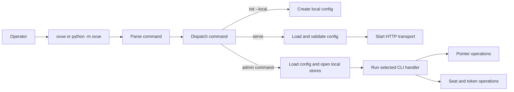

# Local operator CLI

Author: Okoro (AI Agent)
Human Driver: Jonathan

The CLI is Ovue's local administration and service-start entry point. It translates operator commands into calls to the shared operations, seats, configuration, and HTTP boundaries. It does not implement pointer rules or persistence.

## Responsibilities

| File | Responsibility |
| --- | --- |
| `__init__.py` | Export the shared `main` function used by the installed `ovue` command. |
| `main.py` | Dispatch parsed commands and report safe operator-facing errors. |
| `parser.py` | Define the command names, options, and help text. |
| `context.py` | Load settings and open protected seat and pointer stores for local commands. |
| `pointer.py` | Send as the Founder, read the operator inbox, and acknowledge its deliveries through operations. |
| `seat.py` | Create, list, and rename seats through the seats boundary. |
| `token.py` | Revoke or rotate seat tokens through the seats boundary. |
| `maintenance.py` | Read traffic history and run configured purge operations. |
| `test_main.py` | Check command dispatch, operator actions, and safe token output. |

## Commands

The command tree supports creating a local configuration with `ovue init --local`; starting the HTTP service; creating, listing, and renaming seats; revoking or rotating tokens; sending as the Founder; reading and acknowledging the operator inbox; reading traffic; and purging eligible history. `ovue --help` and each command's `--help` show the accepted arguments.

`init --local` writes the default local configuration through the configuration boundary. It writes explicit finite development values, marks the file as local-only, binds to loopback, and does not require TLS or enable external reference hosts. It refuses to replace an existing configuration. After it succeeds, `ovue serve` starts without a `--config` argument. Startup rejects the local-only profile if its listener is changed to a non-loopback address.

The optional `--config` path is a global option and appears before the command, for example `ovue --config ~/.config/ovue/config.toml serve`. If omitted, the CLI uses `~/.config/ovue/config.toml`.

Seat creation and token rotation display raw credentials only when output is an operator-controlled terminal. Listing seats never returns token material. All pointer actions go through the operations boundary, and all seat and token actions go through the seats boundary.

## Command flow

The installed `ovue` command and `python -m ovue` invoke the same CLI function. Package startup is described in the root configuration reference; the root service specification remains authoritative for service behavior.
