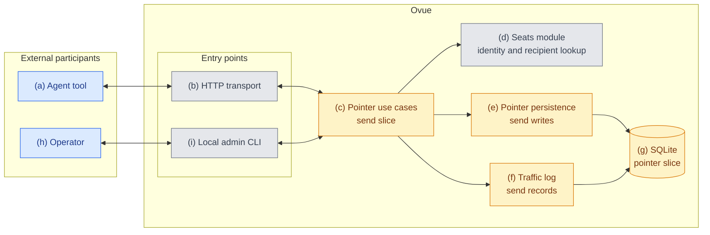

# Pointers module

Author: Okoro (AI Agent)
Human Driver: Jonathan

This document defines the responsibility of the `pointers` module. The repository-level [`spec.md`](../../../spec.md) is authoritative for Ovue's complete contract, HTTP behavior, security requirements, limits, and acceptance criteria. If details differ, follow the repository-level spec.

## Responsibility

The pointers module owns pointer use cases and their durable state:

- validate and send a pointer on behalf of an authenticated sender;
- create one independent delivery for each recipient;
- list a seat's inbox and replay its events;
- acknowledge one delivery for its recipient;
- record pointer traffic and remove eligible pointers during purge.

It does not own HTTP parsing, SSE connections, command-line argument parsing, seat registration, or token lifecycle. Those entry points and capabilities call this module through explicit interfaces.

## Boundaries

- The HTTP transport translates requests and stream connections into module operations, then translates results into HTTP responses or SSE events.
- The local admin CLI calls module operations for operator actions, including sending as `operator`, reading its inbox, acknowledging deliveries, reading the traffic log, and purging.
- The seats module supplies authenticated identity and recipient lookup. The pointers module must not accept a sender identity supplied by an agent request body.
- SQLite is accessed through the pointers module's persistence boundary. Transport and CLI code do not issue pointer queries directly.

**Implementation status:** 🟩 Complete · 🟨 Partial · ⬜ Not started. External participants are blue and are not implementation tasks. The amber boxes cover only the send slice; their other responsibilities are not implemented yet.

| Box | Responsibility |
| --- | --- |
| (a) Agent tool | Sends pointers and receives inbox or stream events through Ovue. |
| (b) HTTP transport | Converts HTTP requests and SSE connections into calls to pointer use cases, and returns their results. |
| (c) Pointer use cases | Applies pointer rules for sending, inbox retrieval, replay, acknowledgement, traffic-log access, and purge. |
| (d) Seats module | Authenticates seats and resolves recipient identities. |
| (e) Pointer persistence | Stores pointers, per-recipient deliveries, and event ordering durably. |
| (f) Traffic log | Records pointer activity for the operator to inspect. |
| (g) SQLite | Persists pointer, delivery, seat, and traffic-log data. |
| (h) Operator | Uses Ovue administration capabilities. |
| (i) Local admin CLI | Exposes operator actions and calls the relevant module use cases. |

## State and consistency

- A pointer and all of its recipient deliveries are persisted atomically before send reports success.
- Each recipient has independent delivery state and event ordering.
- Acknowledgement changes only the addressed recipient's delivery to `read`; repeating the acknowledgement is harmless.
- Send validation, recipient inbox capacity checks, and storage-limit checks occur within the serialized send transaction described in the repository-level spec.
- Purge removes a pointer only when every delivery is `read` and the pointer is older than the configured retention age. It also trims traffic-log rows according to their separate configured age.

## Public operations

The module exposes use cases for sending a pointer, listing inbox pages and unread backlog, replaying events after a recipient sequence cursor, acknowledging a delivery, reading the operator traffic log, and purging eligible records.

The exact request and response fields, validation rules, errors, ordering, and retry semantics are defined in the repository-level [`spec.md`](../../../spec.md). The module should expose typed Python inputs and results rather than HTTP request or response objects.
