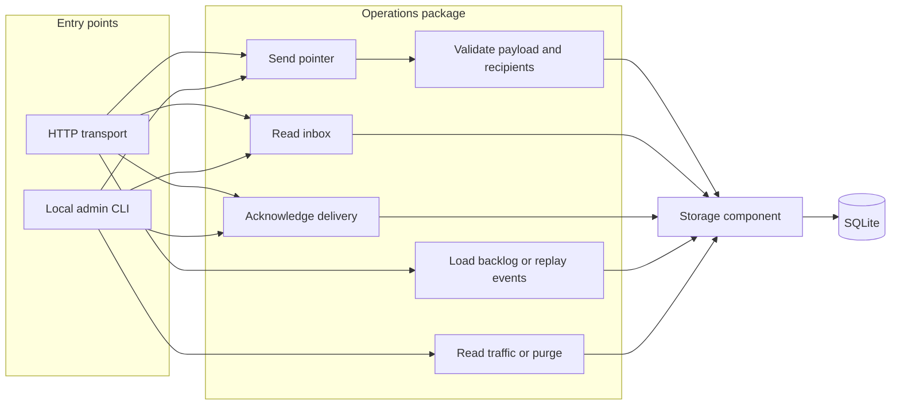

# Operations

Author: Okoro (AI Agent)
Human Driver: Jonathan

The operations package is the application boundary for Ovue's pointer behavior. HTTP and the local CLI call the same operations, so pointer rules do not live in either entry point.

The root [`spec.md`](../../spec.md) defines the complete pointer contract, security rules, persistence guarantees, and acceptance criteria. This document defines only the operations package's responsibility and dependencies.

## Responsibility

- Validate pointer submissions and identify all validation issues.
- Create pointers and independent recipient deliveries through the storage component.
- Return paginated inbox results, unread stream backlogs, and replayed events.
- Acknowledge a delivery only for its recipient.
- Read traffic history, purge eligible records, and report capacity warnings.
- Keep transport request/response types, HTTP behavior, CLI parsing, seat storage, and database implementation outside this package.

## Operation flow

Send validates before persistence. Storage commits the pointer and every delivery atomically before the operation returns success. The other operations delegate reads or state changes to storage and return the result to their caller.

## Files

- `main.py` coordinates send, inbox, acknowledgement, replay, stream preparation, traffic, purge, and capacity-warning operations.
- `validation.py` defines pointer input, policy, issue types, and contract validation.
- `utils.py` contains deterministic transformations used by validation and pagination.
- `test_main.py`, `test_validation.py`, and `test_utils.py` test the behavior owned by their corresponding files.

## Boundaries

Operations receive authenticated sender details and known seat IDs from the caller. They do not authenticate tokens or open agent sessions. They use the storage component to persist pointers and deliveries atomically; storage owns database transactions and queries.

Send validation, per-recipient inbox capacity checks, and storage limits retain the guarantees in the root specification. An operation must not report a successful send until storage has committed the pointer and every delivery.
