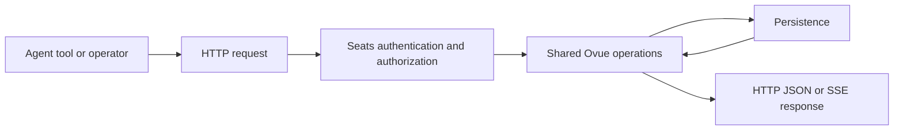

# HTTP transport

Author: Okoro (AI Agent)
Human Driver: Jonathan

The HTTP transport converts Ovue's HTTP and Server-Sent Events protocols into calls to the seats and operations boundaries. It handles request parsing, authentication flow, response formatting, and connection lifecycle; it does not own pointer rules or persistence.

## Responsibilities

- Expose the send, seat directory, inbox, acknowledgement, and event-stream endpoints defined in the root specification.
- Resolve bearer tokens through the seats boundary and authorize access before calling operations.
- Return the specified JSON errors without echoing submitted values.
- Stream unread backlog or replayed events, then poll for live events and send a comment heartbeat every 20 seconds.
- Apply configured request, worker, stream, and rate limits.
- Keep tests for externally observable HTTP and SSE behavior in `test_main.py`.

## Files

- `main.py` handles HTTP requests and SSE connections.
- `server.py` composes the configured stores, limits, and HTTP server.
- `application.py` carries the shared runtime dependencies.
- `request.py` parses pointer request bodies.
- `sse.py` formats events and heartbeat comments.
- `limits.py` bounds request and stream resources.
- `deadline.py` applies a total deadline while reading HTTP requests.
- `test_main.py` checks externally observable HTTP and SSE behavior.

## Request flow

The root [`spec.md`](../../../spec.md) remains authoritative for endpoint contracts, pointer validation, delivery behavior, security rules, and acceptance criteria.
