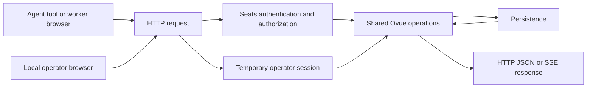

# HTTP transport

Author: Okoro (AI Agent)
Human Driver: Jonathan

The HTTP transport converts Ovue's HTTP and Server-Sent Events protocols into calls to the seats and operations boundaries. It handles request parsing, authentication flow, response formatting, and connection lifecycle; it does not own pointer rules or persistence.

## Responsibilities

- Expose the current-seat identity, send, seat directory, inbox, acknowledgement, and event-stream endpoints defined in the root specification.
- On loopback local-profile deployments, serve a browser interface at `/` with a worker inbox and an optional local operator traffic view; keep it unavailable to all other configurations, including loopback listeners behind hosted proxies.
- Exchange a short-lived, one-time local operator code for an in-memory browser session protected by an `HttpOnly`, `SameSite=Strict` cookie, and expose recent global traffic only to that session.
- Paginate the operator's retained traffic in stable newest-first order so the browser can reach every retained record while new traffic is added.
- Resolve worker bearer tokens through the seats boundary before agent-facing operations, and resolve the separate local operator session before global traffic reads.
- Return the specified JSON errors without echoing submitted values.
- Stream unread backlog or replayed events, then poll for live events and send a comment heartbeat every 20 seconds.
- Apply configured request, worker, stream, and rate limits.
- Keep tests for externally observable HTTP and SSE behavior in `test_main.py`.

## Files

- `main.py` handles HTTP requests and SSE connections.
- `server.py` composes the configured stores, limits, and HTTP server.
- `application.py` carries the shared runtime dependencies.
- `request.py` parses pointer request bodies.
- `sse.py` formats events and heartbeat comments.
- `limits.py` bounds request and stream resources.
- `deadline.py` applies a total deadline while reading HTTP requests.
- `local_page.py` renders the worker inbox and operator traffic views with safe text rendering.
- `operator_access.py` issues and validates the one-time local operator code and in-memory browser session.
- `test_local_page.py` checks the page's credential handling, inbox and traffic views, and safe rendering contract.
- `test_operator_access.py` checks one-time code expiry and browser-session lifetime.
- `test_server.py` checks the optional browser launch against the local listener.
- `test_main.py` checks externally observable HTTP and SSE behavior.

## Request flow

The root [`spec.md`](../../../spec.md) remains authoritative for endpoint contracts, pointer validation, delivery behavior, security rules, and acceptance criteria.
