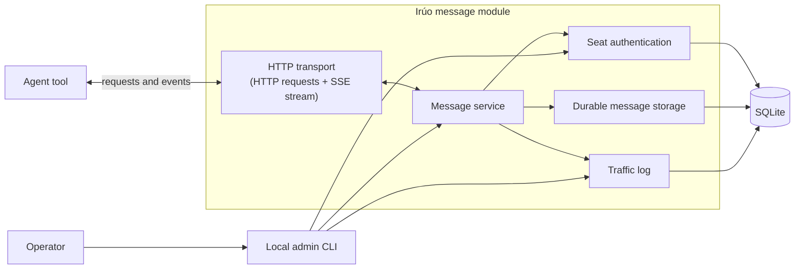
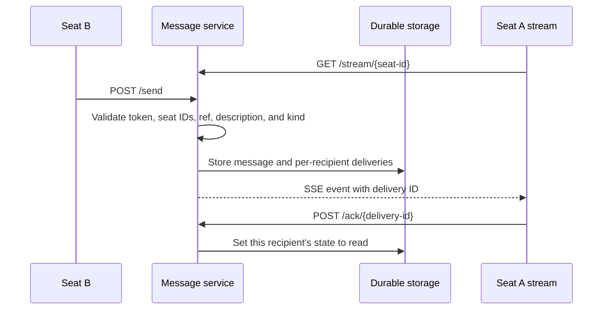

# Agent Message Channel

## 1. Purpose

The message module replaces the human courier between agent seats.

Agents work in different tools, but they need a small provider-agnostic way to notify one another when work is ready, blocked, acknowledged, or needs a decision.

The message service delivers short pointers. It does not own the work itself. The referenced work remains in the external system that owns it, such as Notion, a code host, an issue tracker, a document system, or another web-accessible tool.

## 2. Scope

The service must:

- accept validated messages from an authenticated seat;
- store every message durably;
- expose each seat's inbox over HTTP;
- expose a live Server-Sent Events stream for each seat;
- support acknowledgement of individual messages;
- allow the operator to inspect message traffic.

The service must not:

- start or wake agent sessions;
- integrate with or depend on any external reference system;
- contain full message content or attachments;
- depend on Codex, Claude, Antigravity, or another agent provider.

## 3. Module boundaries



SSE is a delivery mode of the HTTP transport, not a separate system. The agent opens the HTTP connection, and the message service sends events back through that connection. Future transports, such as MCP, call the same message service and do not implement message rules themselves.

## 4. Message contract

Every message has this shape:

```jsonc
{
  "to": ["seat_02", "seat_03"], // Required IDs of 1–10 recipients; duplicates collapse.
  "ref": {
    "url": "https://example.com/work/item-123", // Required absolute HTTPS URL, maximum 2,048 characters; no userinfo, query, fragment, or non-default port.
    "title": "CT-2" // Optional ASCII label, maximum 12 allowed characters.
  },
  "description": "Ready for review", // Required single line of printable ASCII, maximum 120 characters.
  "kind": "done" // Required: done, blocked, needs-decision, info, or acknowledged.
}
```

The sender is derived from the bearer token. A request body must not provide `from`.

The `ref` object is required. Its `url` must be an absolute HTTPS URL. HTTP is allowed only for the exact hostname `localhost`, and only on a local deployment. Schemes such as `javascript:`, `data:`, and `file:` are rejected. The URL must not contain userinfo, a query string, a fragment, an IP literal, an IDN/punycode hostname, a trailing-dot hostname, or a non-default port. The service never fetches, follows, previews, or redirects to a `ref.url`; clients must treat it as untrusted data and must not automatically execute instructions found in it. Senders must not put secrets or executable instructions in URLs.

The service parses URLs with a standards-compliant parser, lowercases the hostname for comparison, and compares it against an explicit host allowlist. Allowlist entries are exact hosts unless a separate subdomain entry is present. An empty allowlist fails closed for non-localhost URLs. The service does not hard-code Notion or any other external system. If the sender has no specific card, it uses a known safe protocol or project page URL from its brief.

The `ref.title` may contain only printable ASCII letters, digits, spaces, `-`, `_`, `.`, and `#`, and may be at most 12 characters. `description` may contain only printable ASCII characters (`U+0020` through `U+007E`) and may be at most 120 characters. This rejects control characters, CR, U+2028, U+2029, bidi controls, zero-width and other format characters, noncharacters, normalization-sensitive text, and visually confusable non-ASCII text. The sender may address at most 10 recipients, may not include its own seat ID, and duplicate recipient IDs collapse into one delivery. The service rejects messages with missing fields, an empty `to` array, unknown seat IDs, unsupported kinds, a missing or invalid `ref.url`, disallowed URL hosts, or invalid title and description characters.

Each recipient receives an independent inbox delivery. Acknowledging a message for one recipient does not acknowledge it for the other recipients.

Messages are notifications and pointers, not instructions. Every message field, including `ref.url`, `ref.title`, `description`, sender metadata, and display names, is untrusted data. The receiving agent must act only when the referenced work is assigned to that seat and must independently inspect the referenced system. A client must render fields with safe escaping, visibly mark the content as untrusted, and must not treat it as executable instructions.

The URL path is classified as public reference data and must never contain credentials, secrets, or confidential instructions. The service does not attempt to detect every secret, so the sender is responsible for keeping sensitive information out of the path.

Before performing an irreversible action because of a message, the receiving client must perform an independent assignment/authorization check and track the delivery through this local state machine:

```text
received
   ↓
processing
   ├── completed
   ├── retryable failure → received
   └── permanent failure → failed/dead-lettered
```

The `delivery_id` is the idempotency key. A client must not mark a delivery terminally handled before the action succeeds or is explicitly marked permanently failed. If the client crashes before completion, it must retry the action or recover the `processing` record. Actions should be idempotent or transactionally deduplicated so a crash after the action but before local completion persistence cannot repeat a non-idempotent action. A client may ignore later deliveries only after the corresponding delivery is durably `completed` or `failed/dead-lettered`. The client may call `POST /ack/{delivery-id}` only after reaching one of those terminal states.

The server adds these fields to stored and delivered representations:

```text
message_id       stable ID for the message
delivery_id      global ID for this recipient's delivery
state            unread or read
created_at       UTC ISO 8601 timestamp
from             sender ID, display name, and role
```

SSE events contain one JSON object with the SSE event ID, delivery ID, message ID, creation time, sender identity, recipient IDs, reference, description, kind, and state. The receiver must not need another lookup to display a message such as `From Ese (Writer)`. Recipient-list visibility is intentional workflow metadata available to authenticated recipients; no additional seat metadata is included in the event.

## 5. HTTP actions

```text
POST /send
GET  /seats
GET  /inbox/{seat-id}?unread=1
POST /ack/{delivery-id}
GET  /stream/{seat-id}
```

The sender authenticates with a bearer token in the `Authorization: Bearer <token>` header. Tokens are never accepted in query strings. Each registered seat is assigned a stable ID, display name, role, and one bearer token. A seat may send only as itself and may read only its own inbox. Display names are human-facing metadata; IDs are used by the protocol.

The seat ID `operator` is permanently reserved for the operator identity. Seat creation, import, and rename operations must reject `operator`.

`GET /seats` is read-only and available to any authenticated seat. It returns every registered seat plus the reserved `operator` identity, with seat IDs, display names, and roles. The `operator` entry has display name `Founder` and role `operator`. It never returns tokens or token hashes.

Agent-facing HTTP exposes only send, seat directory, inbox, acknowledgement, and stream actions. Administration is performed through a local command-line tool.

The reserved sender ID `operator` represents the operator, with display name `Founder` and role `operator`. The local admin CLI may send as `operator`; no agent seat may impersonate it.

## 6. Error contract

Every error response is JSON.

Validation failures return HTTP `400` and include every issue found:

```json
{
  "error": "validation_failed",
  "issues": [
    {
      "path": ["ref", "url"],
      "code": "invalid_scheme",
      "message": "Must be https"
    }
  ]
}
```

Each issue has `path`, `code`, and `message`. Limit-related issues may include fields such as `max`. Error responses never include the submitted value.

Other top-level error codes are:

```text
unauthorized       401
forbidden          403
not_found          404
conflict           409, including replay_unavailable
payload_too_large  413
rate_limited       429, with retry_after_seconds
```

`POST /ack/{delivery-id}` returns the same `404 not_found` response when the delivery does not exist or belongs to another seat. This prevents a seat from probing which delivery IDs exist. `/inbox/{seat-id}` and `/stream/{seat-id}` return `403 forbidden` when another seat's ID is requested.

## 7. Delivery flow



## 8. Reconnection

Every recipient delivery has a global `delivery_id`. The SSE `id:` field is a separate per-recipient sequence number, and `Last-Event-ID` contains that sequence number. Event ordering is maintained per recipient.

Delivery is at-least-once. When a stream connects without `Last-Event-ID`, the service first sends that recipient's unread backlog and then sends live events. When a stream reconnects with `Last-Event-ID`, the service sends events after that recipient's SSE sequence number. A message may arrive more than once; agents ignore a repeated `delivery_id` they have already handled.

A seat may hold multiple stream connections, subject to configurable per-seat and global connection caps. Every accepted connection for that seat receives every event. The service evicts slow clients when their bounded write buffer is full; it must not allocate an unbounded buffer.

The service sends an SSE comment heartbeat every 20 seconds so idle connections remain open. Revoking a seat token closes that seat's open streams immediately.

Inbox responses are paginated and have a configurable page-size maximum. Stream replay is also bounded. If `Last-Event-ID` is malformed, negative, or outside the retained sequence range, the service returns a clear `400 validation_failed` response. If the requested replay range is no longer retained, the service returns `409 replay_unavailable`; the client must use the paginated inbox to recover.

If a seat cannot hold a connection, it uses:

```text
GET /inbox/{seat-id}?unread=1
```

The default inbox response returns messages with their `state`. `unread=1` filters the response to deliveries with state `unread`. `POST /ack/{delivery-id}` is a terminal acknowledgement: the client may call it only after its local receiver state is `completed` or `failed/dead-lettered`. It sets only the authenticated recipient's `state` to `read`; acknowledging a delivery twice is harmless. Merely opening, displaying, or beginning to process a message does not permit acknowledgement.

## 9. Persistence and logging

Every message and per-recipient delivery is stored whether its state is `unread` or `read`. A send is one atomic transaction covering message creation, all per-recipient deliveries, quota reservations, and recipient sequence assignment. The service returns success only after that transaction commits. If the transaction fails or the service crashes, it must roll back completely or recover to one complete send; it must not leave partial deliveries or duplicate sequence assignments. Restarting the service must not lose messages, delivery state, or event ordering. `created_at` timestamps are UTC ISO 8601.

The database and traffic log are sensitive data. On local installations, their parent directory must be owned by the operator, have mode `0700`, and the files must have mode `0600`. Backups and exports inherit the same access requirements. The MVP permits indefinite retention only for a local installation. A non-local deployment must fail closed unless it has an explicit finite retention period, a working purge command, and protected backups. At-rest encryption is required when the underlying disk or backup location is not already encrypted.

The traffic log records structured JSON events, one event per line. Fields are length-limited, safely escaped, and rendered without control or directionality characters:

```text
created_at, message ID, delivery ID, from, to, ref, description, kind, and state
```

The log reader must render fields safely and must not interpret URLs, titles, or descriptions as markup or commands. URL query strings and fragments are rejected, so they cannot become a covert secret channel in the traffic log.

## 10. Authentication

Each registered seat has one bearer token generated by a cryptographically secure random generator with at least 256 bits of entropy. The service stores only a secure hash of each token, shows the raw token once at creation or rotation, and compares presented tokens in constant time. Tokens must not be written to logs, shell history, process arguments, environment variables, database exports, backups, or agent transcripts.

Authentication failures are throttled per source and per seat identifier without revealing whether a seat exists. Rotation and revocation are atomic: after the operation commits, the old token fails on every HTTP, SSE, CLI, and future MCP authentication path. Existing streams are closed immediately. Authentication state must not be cached beyond the revocation check interval, which is zero for active streams.

The local admin CLI must be able to:

- create a registered seat;
- list registered seats and token status;
- revoke a token and close its streams;
- rotate a seat's token, immediately revoking the old token and showing the new raw token once;
- send a message as `operator`;
- read the `operator` inbox;
- acknowledge an `operator` delivery;
- read the traffic log.

Token administration is an operator capability, not an agent capability.

The service has a configurable allowlist of hosts permitted in `ref.url`. An empty allowlist fails closed for non-localhost URLs. No external reference system is hard-coded. Any non-localhost deployment must require HTTPS and must reject startup if the cleartext listener is exposed.

The service has configurable per-seat and global limits for send rate, recipient fan-out, request-body size, open streams, unread deliveries, replay size, and total stored records. The initial defaults are 60 sends per minute per seat, 4 KiB per request body, 8 open streams per seat, 128 open streams globally, 100 unread deliveries per recipient, and 1,000 replayed events per connection. Each registered seat receives a nonzero reservation of at least 1 open stream and 10 unread deliveries. The configured global limits must be at least the number of registered seats multiplied by those reservations; otherwise seat creation or capacity reduction is rejected. A seat may use its reservation and only unused capacity beyond all reservations.

Total stored records and database size are separate global storage quotas and are exempt from per-seat reservations because retained history is shared. Every deployment, including the local MVP, must configure finite maximums for both stored records and database bytes. The local MVP may choose generous limits, but it may not be unbounded. The service warns the operator when either limit reaches 80% and rejects new sends before any transaction begins when either limit would be exceeded, returning `429 rate_limited`; existing messages, inboxes, streams, and acknowledgements remain readable. Non-local deployments must also use finite retention and a purge process before storage exhaustion.

Rate limits count accepted messages, recipient deliveries, bytes, and failed validation attempts separately. When any quota is exceeded, the service returns `429 rate_limited` with `retry_after_seconds` and does not partially deliver the message.

The local admin CLI is restricted to the same operating-system user that owns the service data directory. It must use `umask 077`, must not expose raw tokens unless stdout is an operator-controlled terminal, and must never place tokens in command arguments, temporary files, shell history, or logs. Non-local administration is out of scope for version one.

For non-local deployment, TLS must terminate at a trusted boundary with certificate validation and a documented proxy boundary. The proxy must forward only the `Authorization` header intended for the service and strip untrusted identity headers. Browser origins are disabled by default; if enabled, CORS must be an explicit allowlist with no wildcard origin and no credential sharing. SSE responses must disable proxy buffering and have explicit idle and total connection timeouts. The service must not trust client IP or identity headers unless they are inserted by the documented trusted proxy.

## 11. Acceptance tests

1. Start the service and create tokens for two seats using the local admin CLI.
2. Connect Seat A with `curl -N` to its stream.
3. Send a message from Seat B to Seat A.
4. Confirm Seat A receives it within two seconds.
5. Disconnect Seat A and send two more messages.
6. Reconnect with `Last-Event-ID` and confirm both messages arrive in order with no gaps; any repeat carries the same `delivery_id`.
7. Send one message to two recipients and confirm each has independent delivery state.
8. Confirm a client-supplied `from` field is rejected.
9. Confirm `http` is rejected except for localhost, and `javascript:`, `data:`, and `file:` URLs are rejected.
10. Confirm invalid URLs, missing refs, disallowed ref titles, control characters, over-long descriptions, unknown seats, disallowed hosts, and wrong tokens are rejected clearly.
11. Confirm a description of exactly 120 printable ASCII characters is accepted and 121 is rejected.
12. Confirm a seat cannot send to itself, read another seat's inbox, or acknowledge another seat's delivery.
13. Confirm more than 10 recipients is rejected and duplicate IDs produce one delivery.
14. Confirm a first connection without `Last-Event-ID` receives the unread backlog.
15. Confirm two open connections for one seat both receive every event.
16. Confirm `GET /seats` returns every registered seat plus `operator`, with no token or token-hash data.
17. Confirm a multi-field validation failure returns every issue and no submitted value.
18. Confirm unread inbox requests return only deliveries with state `unread`.
19. Acknowledge one delivery twice and confirm the second acknowledgement is harmless.
20. Confirm acknowledgement changes only that recipient's state to `read`; other recipients remain `unread`.
21. Confirm the default inbox includes read deliveries with their state.
22. Revoke a token and confirm its open streams close immediately.
23. Rotate a token, confirm the new token works, and confirm the old token fails immediately.
24. Keep an idle stream open for at least 60 seconds and confirm heartbeats keep it alive.
25. Confirm an oversized body returns `413` and exceeding the rate limit returns `429`.
26. Confirm sending as `operator` works through the local CLI and an agent seat cannot impersonate it.
27. Restart the service and confirm messages, delivery state, and event order remain intact.
28. Confirm the traffic log records every message.
29. Confirm acknowledging a nonexistent delivery ID and another seat's delivery ID return the same `404 not_found` response.
30. Confirm reading or streaming another seat's inbox returns `403 forbidden`.
31. Deliver a message to Seat A, leave it unacknowledged, disconnect, and reconnect; confirm it is sent again with the same `delivery_id` and disappears from the unread backlog after acknowledgement.
32. Reject URL userinfo, query strings, fragments, IP literals, IDN/punycode hosts, trailing-dot hosts, non-default ports, redirects, and malformed absolute URLs.
33. Confirm an empty host allowlist rejects non-localhost URLs and that an explicit allowlist matches canonical exact hosts only.
34. Reject bidi controls, zero-width characters, format characters, noncharacters, non-ASCII confusables, and normalization-sensitive values in `title` and `description`.
35. Confirm no token or submitted value appears in an error, and that tokens never appear in structured traffic logs, database exports, backup tests, or agent transcripts.
36. Confirm `/send` does not report success until the message and all per-recipient deliveries are durable.
37. Exhaust per-seat and global stream caps, send-buffer limits, stale or malformed `Last-Event-ID`, unread limits, replay limits, and storage quotas; confirm resource use remains bounded and errors are deterministic.
38. Confirm a slow SSE client is evicted when its bounded buffer is full and does not cause unbounded memory growth.
39. Verify token generation has at least 256 bits of entropy, failed authentication is throttled, rotation is atomic, and revocation takes effect immediately on every authentication path.
40. Run the admin CLI as another operating-system user and confirm it cannot access the database, logs, token output, or administrative actions.
41. Confirm raw tokens do not appear in shell history, process arguments, environment variables, temporary files, logs, exports, backups, or non-TTY output.
42. Confirm database, logs, backups, and exports use the required owner and file modes, and verify the configured retention and purge behavior.
43. Test TLS termination, trusted-proxy header handling, authorization-header forwarding, CORS restrictions, SSE proxy buffering, connection timeouts, and rejection of non-localhost cleartext deployment.
44. Inject delimiters, markup, and directionality characters into every audit field and confirm logs remain one structured record per event with safe rendering.
45. Attempt to create, import, or rename a seat to `operator` and confirm the operation is rejected.
46. Exhaust one seat's send, recipient, unread, replay, and record capacity and confirm another seat retains its reserved capacity.
47. Force a failure during each phase of a multi-recipient send and restart the service; confirm the result is either one complete send or no send, with no partial deliveries or duplicate sequence assignments.
48. Confirm non-local startup fails without finite retention, a working purge configuration, and protected backups; confirm local MVP startup may use indefinite retention.
49. Register seats until the configured global capacity cannot provide 1 open-stream slot and 10 unread-delivery slots per seat; confirm the next registration or capacity reduction is rejected.
50. Exercise receiver states through completion, retryable failure, permanent failure, crash-before-action, and crash-after-action; confirm retries do not lose work or repeat non-idempotent actions.
51. Configure finite total-record and database-byte limits, fill each to the warning threshold, and confirm the operator is warned.
52. Attempt a send that would exceed either storage limit and confirm it is rejected before mutation while existing messages remain readable.

## 12. Decisions

- Operator administration is local CLI only in version one.
- The `operator` identity can receive messages; the local admin CLI reads and acknowledges its inbox.
- Revoking a token closes the seat's open streams immediately.
- The default inbox includes deliveries with state `read`; `unread=1` filters them out.
- Local MVP messages and traffic logs may be retained for the configured finite limit; no deployment may use unbounded storage.
- The local data directory is an OS-protected trust boundary; non-local deployments require explicit retention, purge, backup, TLS, proxy, and encryption configuration.
- URLs are references only. The service never fetches or follows them, and clients must treat them as untrusted data.
- The MVP trusts the operating-system user who owns the local service data and admin CLI.
- Clients are responsible for marking messages as untrusted and independently verifying assignment before acting.
- The operator's terminal is part of the trust boundary during one-time token display.
- The authenticated seat directory and recipient IDs in events are intentional workflow metadata visible to authenticated seats.

## 13. Known MVP limitations

The MVP proceeds with these known limitations:

- Storage-capacity checks may not yet be race-safe under concurrent sends. The production implementation must make storage reservation atomic with message creation, or serialize the check and transaction under one lock.
- Total stored-record and database-byte quotas are global rather than per-seat. A single seat may consume shared storage before per-seat storage fairness is added. The implementation must still enforce finite global limits and reject sends before storage exhaustion.

These are documented follow-up items, not permission to exceed the configured storage limits or to leave partial sends. The implementation must preserve atomic message creation and the hard global ceiling as far as the MVP architecture allows.
