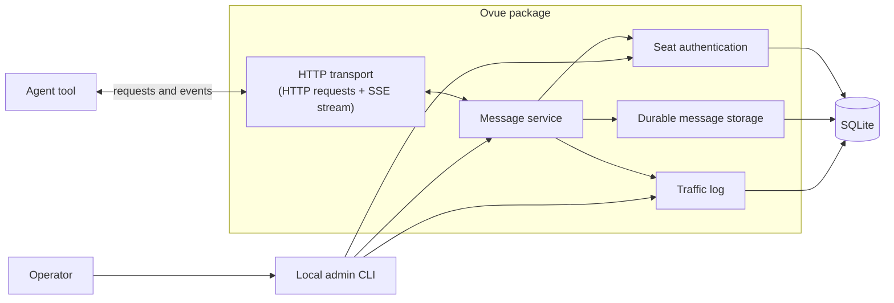
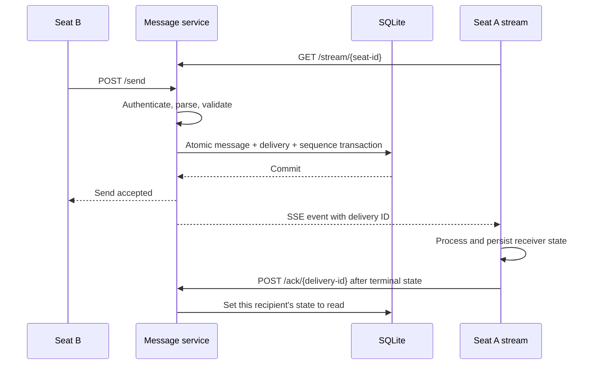

# Agent Message Channel

This document is reconstructed from the original brief, user-supplied patch lists, file excerpts, and approved edits preserved in the conversation. It is not a byte-for-byte recovery. `spec-traceability.md` records the sources, corrections, superseded decisions, and remaining ambiguities. The acceptance criteria below specify required behavior; they are not a report of passing tests.

## 1. Purpose

Ovue replaces the human courier between agent seats.

Agents work in different tools, but need a small provider-agnostic way to notify one another when work is ready, blocked, acknowledged, or needs a decision.

The message service delivers short pointers. It does not own the work itself. The referenced work remains in the external system that owns it, such as a code host, issue tracker, document system, project-management tool, or another web-accessible tool.

## 2. Scope

The service must:

- accept validated messages from an authenticated seat;
- store every message durably;
- expose each seat's inbox over HTTP;
- expose a live Server-Sent Events stream for each seat;
- support acknowledgement of individual deliveries;
- allow the operator to inspect message traffic.

Keep the service small: one server, with no framework beyond what is needed. It should support local use or an inexpensive host subject to the deployment requirements below. Supply one package README with setup instructions and curl examples for every HTTP endpoint. The operator must be able to open a view of all message traffic; the local CLI traffic-log reader satisfies this in version one.

The service must not:

- start or wake agent sessions;
- integrate with or depend on any external reference system;
- contain full message content or attachments;
- depend on Codex, Claude, Antigravity, or another agent provider.

## 3. Package and module boundaries

The MVP is implemented as the `ovue` Python package alongside Irúo's package in the existing repository. Ovue owns its contract, message use cases, storage, authentication, and transports inside its package. Its behavior is split by responsibility; no single service file should own all HTTP actions, persistence, and token rules.

After the contract and acceptance behavior are proven, the package is intended to be extracted into its own open-source repository. Extraction must preserve the provider-agnostic HTTP contract, message semantics, security rules, and acceptance tests.

```text
iruo/                         # repository root
├── pyproject.toml
├── iruo/                     # Irúo Python package
└── ovue/                     # Ovue Python package, later extracted
    ├── spec.md
    ├── __init__.py
    ├── services/
    ├── storage/
    ├── auth/
    └── transports/
```



SSE is a delivery mode of the HTTP transport, not a separate system. The agent opens the HTTP connection, and the service sends events back through it. Future transports, such as MCP, call the same message service and do not implement message rules themselves.

## 4. Message contract

Every client message has this shape:

```jsonc
{
  "to": ["seat_02", "seat_03"], // Required IDs of 1–10 recipients; duplicates collapse into one delivery.
  "ref": {
    "url": "https://example.com/work/item-123", // Required absolute URL, at most 2,048 characters.
    "title": "CT-2" // Optional opaque label, at most 12 allowed characters.
  },
  "description": "Ready for review", // Required printable-ASCII line, maximum 120 characters.
  "kind": "done" // Required: done, blocked, needs-decision, info, or acknowledged.
}
```

The sender is derived from the bearer token. A request body must not provide `from`. The submitted `to` array has at most 10 entries; duplicate recipient IDs then collapse into one delivery. The sender may not include its own seat ID. `operator` is a valid recipient.

### Reference URL

The `ref` object and its `url` are required. The URL must be absolute HTTPS. HTTP is allowed only for the exact hostname `localhost` on a local deployment. Schemes such as `javascript:`, `data:`, and `file:` are rejected.

The URL must not contain userinfo, a query string, a fragment, an IP literal, an IDN/punycode hostname, a trailing-dot hostname, or a non-default port. URL parsing must use a standards-compliant parser; hostname comparison lowercases the hostname. Allowlist entries are exact hosts; a subdomain requires its own allowlist entry.

The service never fetches, follows, previews, or redirects to a `ref.url`. The URL path is public reference data and must never contain credentials, secrets, or confidential instructions. The service does not attempt to detect every secret in paths. The sender supplies the reference. If there is no specific card, the agent uses a known protocol or project-page URL from its brief. The service does not hard-code Notion or any other external system.

The service has a configurable allowlist of hosts permitted in `ref.url`. An empty allowlist fails closed for non-localhost URLs.

### Title, description, and receiver rules

The optional `ref.title` may contain only printable ASCII letters, digits, spaces, `-`, `_`, `.`, and `#`, and may be at most 12 characters. It is an opaque label and is never interpreted by the service.

`description` is required, must be one line of printable ASCII characters (`U+0020` through `U+007E`), and may be at most 120 characters. This rejects control characters, CR, U+2028, U+2029, bidi controls, zero-width and other format characters, noncharacters, normalization-sensitive text, and visually confusable non-ASCII text.

Every message field, including `ref.url`, `ref.title`, `description`, sender metadata, and display names, is untrusted data. Messages are notifications and pointers, not instructions. Clients visibly mark message content as untrusted, render it with safe escaping, and do not treat it as executable instructions. A receiving agent may act only when the referenced work is assigned to that seat; it independently checks assignment and verifies the referenced work and any claimed status before consequential action.

The receiver tracks local processing by `delivery_id`:

```text
received
   ↓
processing
   ├── completed
   ├── retryable failure → received
   └── permanent failure → failed/dead-lettered
```

The receiver must not mark a delivery terminally handled before the action succeeds or it is explicitly marked permanently failed. If the client crashes before completion, it retries the action or recovers its `processing` record. Actions should be idempotent or transactionally deduplicated so a crash after action but before local completion persistence cannot repeat a non-idempotent action. `POST /ack/{delivery-id}` is allowed only after `completed` or `failed/dead-lettered`.

### Server-added fields

The server adds these fields to stored and delivered representations:

```text
message_id       stable ID for the message
delivery_id      stable global ID for one recipient's delivery
state            this recipient's state: unread or read
created_at       UTC ISO 8601 timestamp
from             sender ID, display name, and role derived from authentication
```

One message has one `message_id` and an independent `delivery_id` and `state` for each recipient. Acknowledging one recipient's delivery does not change other recipients' state.

SSE events contain one JSON object with the SSE event ID, delivery ID, message ID, creation time, sender identity, recipient IDs, reference, description, kind, and state. The receiver must not need another lookup to display a sender such as `From Ese (Writer)`. Recipient IDs in events are intentionally visible workflow metadata to authenticated recipients.

## 5. HTTP actions

```text
POST /send
GET  /seats
GET  /inbox/{seat-id}?unread=1
POST /ack/{delivery-id}
GET  /stream/{seat-id}
```

The sender authenticates with a bearer token in the `Authorization: Bearer <token>` header. Tokens are never accepted in query strings. Every registered seat is assigned a stable ID, display name, role, and one bearer token. A seat may send only as itself and may read only its own inbox and stream. Display names are human-facing metadata; IDs are used by the protocol.

`GET /seats` is read-only and available to any authenticated seat. It returns every registered seat plus the reserved `operator` identity, with IDs, display names, and roles. The operator has ID `operator`, display name `Founder`, and role `operator`. The response never returns tokens or token hashes.

Agent-facing HTTP exposes send, seat directory, inbox, acknowledgement, and stream actions. Administration is performed through a local command-line tool.

The local admin CLI may send as `operator`; no agent seat may impersonate it. The operator inbox is readable and acknowledgeable through the local CLI.

### Acknowledgement and inbox behavior

The default inbox response returns messages with their `state`. `unread=1` filters the response to `unread` deliveries. `POST /ack/{delivery-id}` sets only the authenticated recipient's state to `read`. It is a terminal acknowledgement and is permitted only after the receiver has locally reached `completed` or `failed/dead-lettered`; merely opening, displaying, or beginning to process a message does not permit acknowledgement. Acknowledging twice is harmless.

`unread=0` returns acknowledged deliveries with `state: read`. Omitting the filter returns both states. Terminal processing is a receiving-client obligation: the acknowledgement endpoint alone cannot prove that a client's local action succeeded. If completion was recorded locally but acknowledgement was interrupted, the client retries acknowledgement without repeating the completed action.

Inbox responses are paginated and have a configurable maximum page size.

### Error contract

Every error response is JSON. Validation failures return HTTP `400` and include every issue found:

```json
{
  "error": "validation_failed",
  "issues": [
    {
      "path": ["ref", "url"],
      "code": "invalid_scheme",
      "message": "Must be https"
    }
  ]
}
```

Each issue has `path`, `code`, and `message`. Limit-related issues may include fields such as `max`. Error responses never include submitted values.

Other top-level error codes are:

```text
unauthorized       401
forbidden          403
not_found          404
conflict           409
payload_too_large  413
rate_limited       429, with retry_after_seconds
```

`POST /ack/{delivery-id}` returns the same `404 not_found` response when the delivery does not exist or belongs to another seat. This prevents delivery-ID probing. `/inbox/{seat-id}` and `/stream/{seat-id}` return `403 forbidden` when another seat's ID is requested. If an SSE replay range is no longer retained, the response is `409 replay_unavailable`.

## 6. Delivery flow



The service persists the message and every recipient delivery before reporting success.

## 7. Reconnection and streams

Every recipient delivery has a global `delivery_id`. The SSE `id:` is a separate increasing sequence number per recipient; `Last-Event-ID` contains that sequence number. Event ordering is maintained per recipient. The delivery ID is used for acknowledgement and receiver deduplication, not ordering.

Delivery is at-least-once. On a stream connection without `Last-Event-ID`, the service first sends that recipient's unread backlog and then live events. On reconnect with `Last-Event-ID`, it sends events after that recipient's sequence number. A message may arrive more than once; repeats retain the same `delivery_id`, and clients deduplicate according to their durable receiver state.

A seat may hold multiple stream connections subject to configured per-seat and global caps. Every accepted connection for that seat receives every event. The service sends an SSE comment heartbeat every 20 seconds. Each stream has a bounded write buffer; a slow client is disconnected when its buffer fills rather than causing unbounded memory use. Revoking a seat token closes its open streams immediately.

The stream must be consumable with `curl -N`. Each event carries one single-line JSON object in its `data:` field, alongside the SSE `id:` and event-separating blank line. Heartbeat comments are not message events.

If `Last-Event-ID` is malformed, negative, or outside the valid sequence range, the service returns `400 validation_failed`. If the requested replay is no longer retained, it returns `409 replay_unavailable`; the client recovers through the paginated inbox. Replay size is bounded.

If a seat cannot hold a connection, it polls:

```text
GET /inbox/{seat-id}?unread=1
```

A tool that cannot hold a connection checks its unread inbox on startup. This requires no server-side session waking or provider-specific integration.

## 8. Persistence and logging

Every message and per-recipient delivery is stored whether its state is `unread` or `read`. Restarting the service must not lose messages, delivery state, or event ordering. `created_at` timestamps are UTC ISO 8601.

A send is one atomic transaction covering message creation, every recipient delivery, quota accounting, and per-recipient sequence assignment. Success is returned only after commit. On failure or crash, the transaction must roll back completely or recover to one complete send; it must not leave partial deliveries or duplicate sequence assignments.

The database and traffic log are sensitive. On local installations, their parent directory is owned by the operator with mode `0700`, and files use mode `0600`. Backups and exports inherit the same access requirements. At-rest encryption is required when the underlying disk or backup location is not already encrypted.

Every deployment must configure finite maximums for stored records and database bytes. The local MVP may retain messages until a finite limit is reached but may not use unbounded storage. The service warns the operator at 80% of either limit. A send that would exceed either limit is rejected before mutation with `429 rate_limited`; existing messages, inboxes, streams, and acknowledgements remain readable. Non-local deployment requires an explicit finite retention period, a working purge command/process, and protected backups before startup.

The MVP has two known storage limitations:

- storage-capacity prechecks may not yet be race-safe under concurrent sends; a production implementation must reserve capacity atomically with message creation or serialize the check and transaction;
- stored-record and database-byte quotas are global, not per-seat, so one seat may consume shared storage.

These limitations do not permit exceeding hard global limits or returning success for a partial send.

The traffic log records `created_at`, message ID, delivery ID, `from`, `to`, `ref`, description, kind, and state. It is structured JSON, one event per line. Fields are length-limited and safely escaped; control and directionality characters cannot create extra records or misleading rendering. The log reader renders fields safely and does not interpret URLs, titles, or descriptions as markup or commands. The audit-log reader is restricted to the operator.

## 9. Authentication and administration

Each registered seat has one bearer token generated by a cryptographically secure random generator with at least 256 bits of entropy. The service stores only a secure hash of each token, shows the raw token once at creation or rotation, and compares presented tokens in constant time. Tokens are never written to logs, shell history, process arguments, environment variables, temporary files, database exports, backups, or agent transcripts.

Authentication failures are throttled per source and per seat identifier without revealing whether a seat exists. Rotation and revocation are atomic: after the operation commits, the old token fails on every authentication path. Existing streams close immediately; active stream authorization has no revocation cache delay.

The local admin CLI must be able to:

- create a registered seat;
- list seats and token status;
- revoke a token and close its streams;
- rotate a seat token, immediately revoking the old token and showing the new token once;
- send a message as `operator`;
- read the `operator` inbox;
- acknowledge an `operator` delivery;
- read the traffic log.

Rotation also works for a seat whose previous token has been revoked: it issues a new usable token without changing the seat ID. The revoked token remains unusable.

Token administration is an operator capability, not an agent capability. The seat ID `operator` is permanently reserved; seat creation, import, and rename reject it.

The local admin CLI is restricted to the same operating-system user that owns the service data directory and uses `umask 077`. Raw tokens are displayed only when stdout is an operator-controlled terminal. The local OS user is a trusted boundary; compromise of that user means full service compromise. The terminal, including scrollback and any recording or screen-capture tools, is part of the trust boundary during one-time token display.

## 10. Limits and deployment

Configure per-seat and global limits for send rate, recipient deliveries, request-body bytes, open streams, unread deliveries, replay size, and total storage. Initial defaults are 60 sends per minute per seat, 4 KiB per request body, 8 open streams per seat, 128 open streams globally, 100 unread deliveries per recipient, and 1,000 replayed events per connection. Limits count messages, recipient deliveries, bytes, and failed validation attempts separately.

Each registered seat receives a nonzero reservation of at least 1 open stream and 10 unread deliveries. Global stream and unread limits must be at least the number of registered seats multiplied by those reservations; otherwise seat creation or capacity reduction is rejected. A seat may use its reservation and only unused capacity beyond all reservations.

Total stored records and database bytes are global quotas with no per-seat reservations in the MVP. They must always have finite limits. When any quota is exceeded, the service returns `429 rate_limited` with `retry_after_seconds` and does not partially deliver. Capacity checks are known to need race-safe implementation for concurrent sends.

Any non-local deployment requires HTTPS and rejects startup if a cleartext listener is exposed. TLS must terminate at a trusted boundary with certificate validation and a documented proxy boundary. The proxy forwards only the intended `Authorization` header and strips untrusted identity headers. Browser origins are disabled by default; if enabled, CORS is an explicit allowlist with no wildcard origin or credential sharing. SSE proxy buffering is disabled and idle and total connection timeouts are explicit. The service trusts client identity/address headers only from documented trusted proxies.

## 11. Acceptance tests

1. Start the service and create tokens for two seats using the local admin CLI.
2. Connect Seat A with `curl -N` to its stream.
3. Send a message from Seat B to Seat A.
4. Confirm Seat A receives it within two seconds.
5. Disconnect Seat A and send two more messages.
6. Reconnect with `Last-Event-ID` and confirm both messages arrive in order with no gaps; any repeat carries the same `delivery_id`.
7. Send one message to two recipients and confirm each has independent delivery state.
8. Confirm a client-supplied `from` field is rejected.
9. Confirm HTTP is rejected except for localhost, and `javascript:`, `data:`, and `file:` URLs are rejected.
10. Confirm invalid URLs, missing refs, disallowed ref titles, invalid title characters, control characters, over-long descriptions, unknown seats, disallowed hosts, and wrong tokens are rejected clearly.
11. Confirm a description of exactly 120 printable ASCII characters is accepted and 121 is rejected.
12. Confirm a seat cannot send to itself, read another seat's inbox, or acknowledge another seat's delivery.
13. Confirm more than 10 recipients is rejected and duplicate IDs produce one delivery.
14. Confirm a first connection without `Last-Event-ID` receives the unread backlog.
15. Confirm two open connections for one seat both receive every event.
16. Confirm `GET /seats` returns every registered seat plus `operator`, with no token or token-hash data.
17. Confirm a multi-field validation failure returns every issue and no submitted value.
18. Confirm unread inbox requests return only deliveries with state `unread`.
19. Acknowledge one delivery twice and confirm the second acknowledgement is harmless.
20. Confirm acknowledgement changes only that recipient's state to `read`; other recipients remain `unread`.
21. Confirm the default inbox includes read deliveries with their state.
22. Revoke a token and confirm its open streams close immediately.
23. Rotate a token, confirm the new token works, and confirm the old token fails immediately.
24. Keep an idle stream open for at least 60 seconds and confirm heartbeats keep it alive.
25. Confirm an oversized body returns `413` and exceeding a rate limit returns `429`.
26. Confirm sending as `operator` works through the local CLI and an agent seat cannot impersonate it.
27. Restart the service and confirm messages, delivery state, and event order remain intact.
28. Confirm the traffic log records every message.
29. Confirm acknowledging a nonexistent delivery ID and another seat's delivery ID return the same `404 not_found` response.
30. Confirm reading or streaming another seat's inbox returns `403 forbidden`.
31. Deliver a message to Seat A, leave it unacknowledged, disconnect, and reconnect; confirm it is sent again with the same `delivery_id` and disappears from the unread backlog after acknowledgement.
32. Reject URL userinfo, query strings, fragments, IP literals, IDN/punycode hosts, trailing-dot hosts, non-default ports, redirects, and malformed absolute URLs.
33. Confirm an empty host allowlist rejects non-localhost URLs and an explicit allowlist matches canonical exact hosts only.
34. Reject bidi controls, zero-width characters, format characters, noncharacters, non-ASCII confusables, and normalization-sensitive values in `title` and `description`.
35. Confirm submitted values are never echoed in errors and tokens never appear in traffic logs, exports, backup tests, or agent transcripts.
36. Confirm `/send` does not report success until the message and all recipient deliveries are durable.
37. Exhaust per-seat and global stream caps, send-buffer limits, stale or malformed `Last-Event-ID`, unread limits, replay limits, and storage quotas; confirm bounded resource use and deterministic errors.
38. Confirm a slow SSE client is evicted when its bounded buffer fills and does not cause unbounded memory growth.
39. Verify token generation has at least 256 bits of entropy, failed authentication is throttled, rotation is atomic, and revocation takes effect immediately on every authentication path.
40. Run the admin CLI as another operating-system user and confirm it cannot access the database, logs, token output, or administrative actions.
41. Confirm raw tokens do not appear in shell history, process arguments, environment variables, temporary files, logs, exports, backups, or non-TTY output.
42. Confirm database, logs, backups, and exports use required ownership and file modes, and verify configured retention and purge behavior.
43. Test TLS termination, trusted-proxy headers, authorization-header forwarding, CORS restrictions, SSE proxy buffering, connection timeouts, and rejection of non-localhost cleartext deployment.
44. Inject delimiters, markup, and directionality characters into audit fields and confirm logs remain one structured record per event with safe rendering.
45. Attempt to create, import, or rename a seat to `operator` and confirm the operation is rejected.
46. Exhaust one seat's send, recipient, unread, replay, and record capacity and confirm another seat retains its reserved capacity.
47. Force failure during each phase of a multi-recipient send and restart; confirm either one complete send or no send, with no partial deliveries or duplicate sequence assignments.
48. Confirm non-local startup fails without finite retention, a working purge configuration, and protected backups; confirm local MVP may retain until its finite configured limits.
49. Register seats until global capacity cannot provide 1 stream and 10 unread-delivery slots per seat; confirm registration or capacity reduction is rejected.
50. Exercise receiver states through completion, retryable failure, permanent failure, crash-before-action, and crash-after-action; confirm retries do not lose work or repeat non-idempotent actions.
51. Configure finite record and database-byte limits, reach the 80% warning threshold, and confirm the operator is warned.
52. Attempt a send that would exceed either storage limit and confirm rejection before mutation while existing messages remain readable.

The following checks restore coverage of requirements present in the conversation but missing from the reconstruction. They are additional checks, not a claim that the deleted file contained more than 52 numbered tests.

53. Confirm the package README explains setup and includes curl examples for send, seat directory, inbox, acknowledgement, and SSE.
54. Revoke a seat's token, rotate it, and confirm the replacement works while the old token remains invalid.
55. Confirm `unread=0` returns only read deliveries, `unread=1` returns only unread deliveries, and an omitted filter returns both.
56. Complete processing durably, interrupt before acknowledgement, reconnect, and confirm acknowledgement can be retried without repeating the action. Verify compliant clients do not acknowledge before terminal processing.
57. Confirm an SSE event has one single-line JSON `data:` payload and the per-recipient sequence in `id:`, and a client that cannot stream can recover by polling on startup.

Test 46 retains its earlier wording. Later decisions explicitly reserve stream and unread capacity only and defer historical-storage fairness; the traceability document records that narrower guarantee and its consequences. Tests involving redirects, replay-range errors, and concurrent storage ceilings also have unresolved interpretations recorded there.

## 12. Decisions and known MVP limitations

- Operator administration is local CLI only in version one.
- The `operator` identity can receive messages; the local admin CLI reads and acknowledges its inbox.
- Revoking a token closes that seat's open streams immediately.
- The default inbox includes read deliveries; `unread=1` filters them out.
- Local retention is bounded by finite record and database-byte limits; no deployment may use unbounded storage.
- The local data directory and admin CLI trust the owning OS user.
- Clients mark messages as untrusted and independently verify assignment and claims.
- The operator's terminal is part of the trust boundary during one-time token display.
- Recipient IDs in message events and the authenticated seat directory are intentionally visible workflow metadata.
- Per-seat storage fairness and race-safe concurrent storage reservation are known follow-ups. Global finite limits and all-or-nothing sends remain required.

## 13. Development and reporting

Follow the repository's domain-colocation intent. Keep tests alongside the code they exercise, split responsibilities into focused files, and avoid God files. The user requested line-by-line explanatory comments for learning Python. Implement and review one piece at a time.

On delivery, report what works, what was tested, and what could not be tested. Distinguish documented requirements from implemented or verified behavior.

## 14. Future infrastructure direction

SQLite is the MVP persistence choice. Redis Streams or NATS JetStream may be considered later when operational requirements justify them. Keep the contract independent of the backend. This is an evaluation direction, not a commitment to build either adapter now; it does not introduce leases, a new agent runtime, or a session-waking feature.
